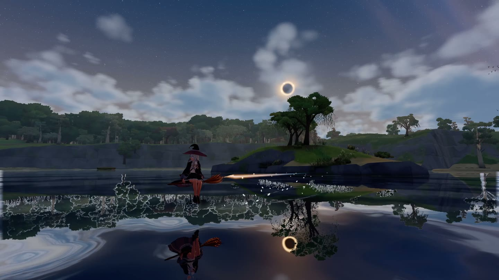
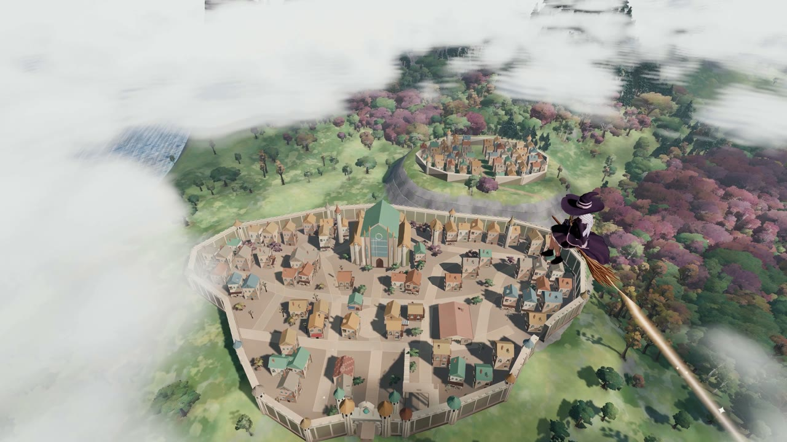

# 魔女之旅 · 骑帚旅行

扮演伊蕾娜，从故乡的书桌出发，穿过芙兰居住的森林，骑扫帚前往魔法使之国。这款免费的第三人称同人冒险游戏把动画前两话改编成一段可以亲自飞完的旅程。你可以跟着旅行手记学魔法，也可以绕个远路，贴着星痕湖看一场日食。



## 开始旅行

准备 Node.js 22.12 或更新版本，以及支持 WebGL 2 的桌面浏览器。在终端运行以下命令。首次启动会在本地生成地形数据。

```sh
git clone https://github.com/shoal-rat/majo-no-tabitabi.git
cd majo-no-tabitabi
npm ci
npm run serve
```

在浏览器打开 `http://127.0.0.1:8751/`，选择**踏上旅途**。走到家里的书桌旁按 **E** 翻开旅行记。**J** 能看到当前目标，**M** 可以查地图。进度保存在当前浏览器。下次使用同一浏览器和地址，选**继续**即可。

想看清云影、水面倒影和掠水尾流，可以用 `http://127.0.0.1:8751/?quality=high&dynres=0` 进入最高画质。普通入口会按设备选择画质，并可动态调整渲染分辨率。

## 两话的行程

- **第一话 · 见习魔女伊蕾娜**　从故乡到森林小屋拜师，在空地上练习风魔法。对练时留意芙兰的杖尖，赶在来弹接近时举盾，可以把魔法弹送回去。授名后，戴上胸针与母亲道别。
- **第二话 · 魔法使之国**　向西渡过星痕湖，穿越旷野，从南城门的拱洞飞入城。与沙耶在屋顶相遇之后，要修复屋瓦、寻找旅馆，还要亲自带她练习穿过三道飞行环。

两话取材自动画《魔女之旅》，对白为游戏重新编写。芙兰的陨石、落地后长期保留的湖盆和渡湖时的日食是这次同人改编加入的情节。两话结束后仍可自由探索，也可回到森林空地找芙兰再次对练。[动画官方网站](https://majotabi.jp/)



从东端普通巡航到西端约需五分钟。贴水飞行能看见扫帚留下的尾流，升高则能穿过随风移动的体积云。城外一场雨过后，云影会从山坡移过，露出进城的路。授名后学会的岩石魔法还能在旷野留下凹坑，读档后可以回到原地查看。

## 常用操作

| 动作 | 默认键位 |
| --- | --- |
| 移动、转动视角 | W A S D、鼠标 |
| 调查或交谈、推进对白 | E、Enter |
| 召唤或收起扫帚 | F |
| 骑帚上升、下降、加速 | 空格、C、Shift |
| 选择魔法 | 数字键，或按住 Tab 打开轮盘 |
| 施放魔法 | 点按鼠标右键。已解锁的进阶术式可按住蓄力后松开 |
| 闪避、防护 | Q、R |
| 旅行手记、地图 | J、M |

## 构建与开发

游戏使用 JavaScript、Three.js 和 Rapier。开发服务器会在刷新页面时重新构建。要生成可由静态服务器托管的版本，在项目根目录运行 `npm run release`，将生成的整个 `dist/` 目录一并部署。

在 macOS 上也可以构建 Electron 应用。先完成上面的 `npm ci`，再安装桌面端依赖并打包。

```sh
npm ci --prefix desktop
npm run package:mac
```

打包脚本会启动成品做一次检查，应用位于 `release/魔女之旅-darwin-<架构>/魔女之旅.app`。

| 想修改的内容 | 从这里开始 |
| --- | --- |
| 主线步骤和完成条件 | [两话任务](src/story/questdefs.js) |
| 对练和陨石演出 | [芙兰对练](src/story/fran-spar.js) · [陨石](src/story/fran-meteor.js) |
| 湖区、野外和城内的地点 | [地图坐标](src/data/journey-map.js) · [星痕湖地形](src/world/trial-lake.js) |
| 天气、云层和倒影 | [旅途天气](src/world/journey-weather.js) · [天空](src/world/sky.js) · [水面](src/world/water.js) |
| 任务说明与人物对白 | [任务文本](src/locales/zh-CN/story.quests.js) · [主线对白](src/locales/zh-CN/story.dlg.main.js) |

修改玩法后，可用本机 Chrome、Chromium 或 Edge 运行以下验收。测试使用单独的浏览器存档。浏览器安装在自定义位置时，将 `CHROME_BIN` 指向其可执行文件。

```sh
node tools/acceptance/journey-story.mjs   # 两话主线、读档以及芙兰试炼的两种结局
node tools/acceptance/journey-eclipse.mjs # 渡湖日食、复明和水面反射
```

欢迎用 Issue 报告卡关、穿模、光影或性能问题。请附上当前手记目标、所处地点、触发步骤，以及浏览器和画质档位。涉及画面的情况可以附一张实机截图。提交修改时请从自己的分支发起 Pull Request；合并前会自动构建游戏并检查角色模型。

## 开源与素材

这是爱好者独立维护的非官方、非营利项目。项目原创程序以 MIT 许可开放，可以学习、修改、分发，也可以商业使用这些代码。[代码许可证](LICENSE)

《魔女之旅》的作品名、角色和原作设定归各自权利人所有。游戏资源沿用各自许可；本项目对独立生成的美术和 CC0 素材不另加署名要求。第三方模型、音乐、音效及字体的作者、来源和许可集中收录，便于再分发时一并保留。[素材与授权](CREDITS.md) · [逐项素材清单](assets/manifest.json)
